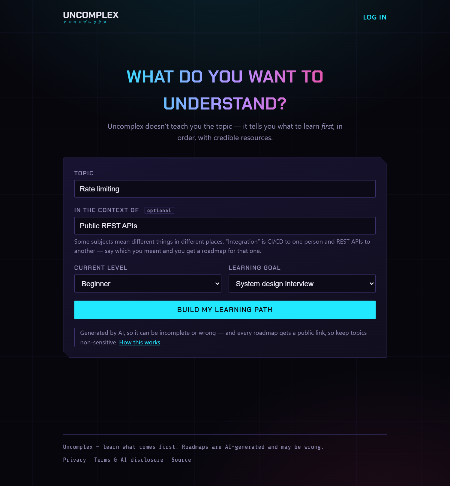
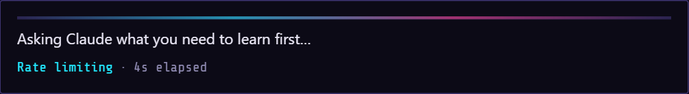
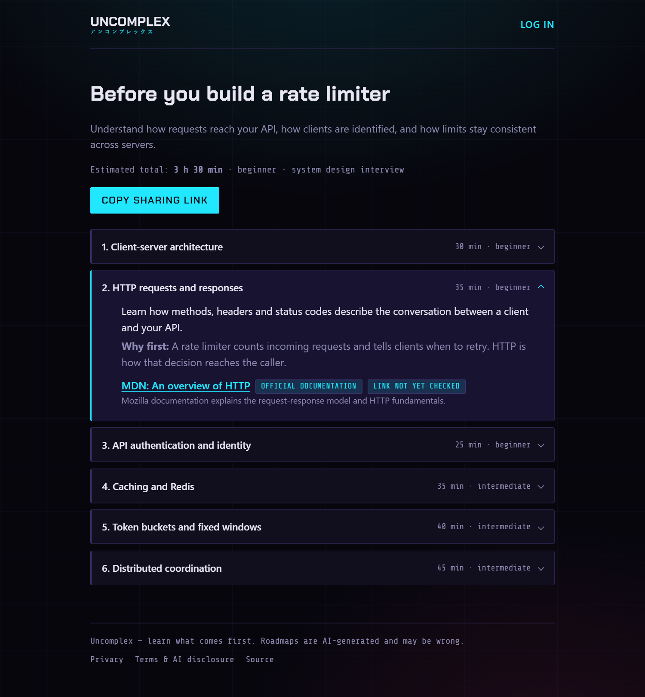
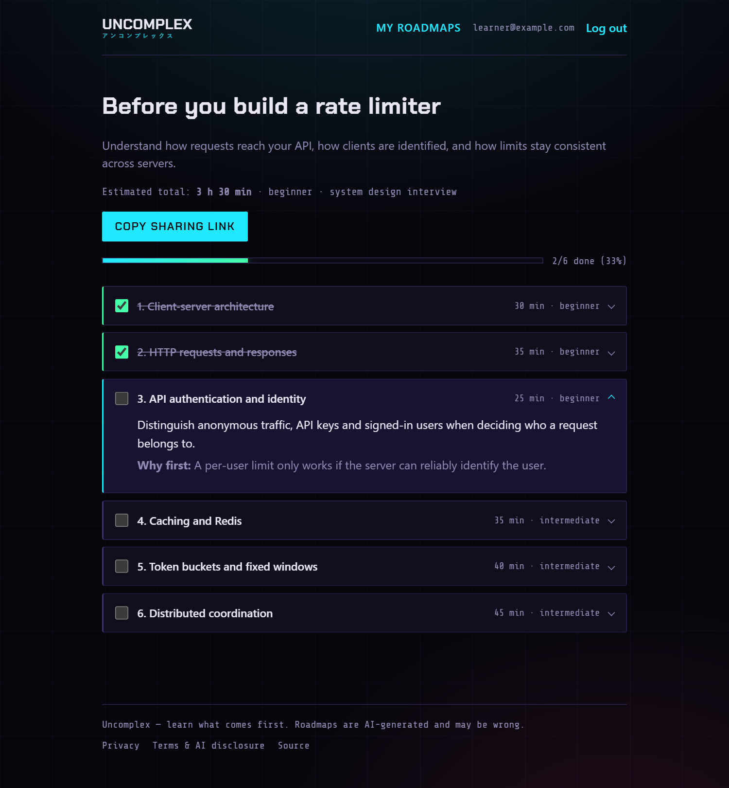
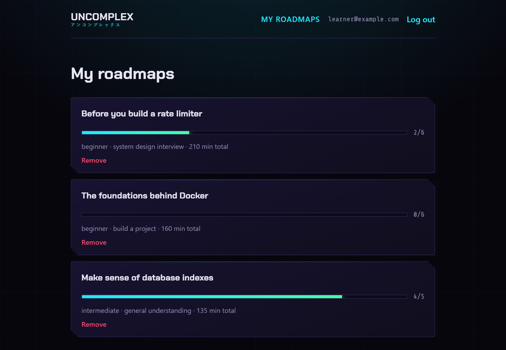
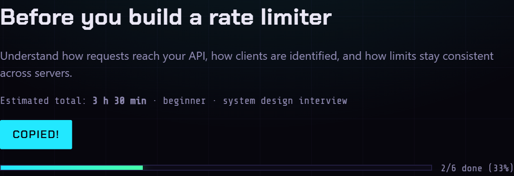
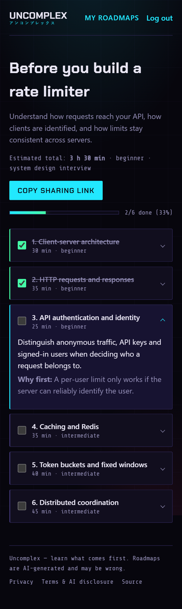
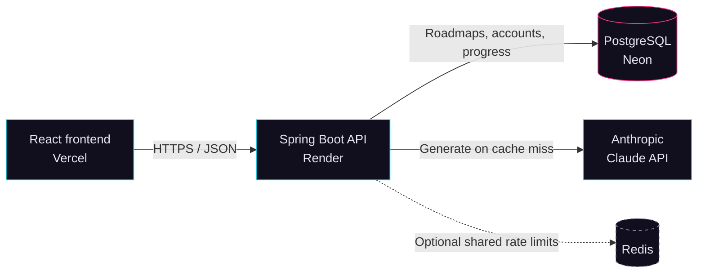

<div align="center">

# Uncomplex

**Understand what comes first. Then learn the thing you came for.**

Turn a topic, your current level, and a learning goal into an ordered prerequisite roadmap with explanations and resources.

[](https://github.com/Jainoir/Uncomplex/actions/workflows/ci.yml)

**[Try it live](https://uncomplex.vercel.app)** · [Run locally](#run-it-yourself) · [Services & accounts](SERVICES.md) · [API health](https://uncomplex-api.onrender.com/actuator/health)

<sub>The first request after idle can be slow while the hosted API wakes up. Opening the homepage starts a background warm-up.</sub>

<p></p>

<sub>A condensed walkthrough of the current interface, using example API responses and a shortened generation wait. Follow the still screenshots below at your own pace.</sub>

</div>

When a topic doesn't click, the missing piece is often something underneath it. Uncomplex makes those prerequisites explicit: **what to understand, why it matters, and what to learn next**.

| Explore immediately | Understand the path | Keep your place |
| --- | --- | --- |
| Generate and open shared roadmaps without an account. | Get 4–8 ordered concepts with explanations, time estimates, and resource links. | Sign in to save roadmaps and track your own progress. |

**Jump to:** [How it works](#how-it-works) · [Tech stack](#tech-stack) · [Run it yourself](#run-it-yourself) · [API](#api) · [Architecture](#architecture) · [System design & patterns](#system-design-and-patterns) · [Design decisions](#design-decisions-and-why) · [Testing](#testing-strategy) · [Configuration](#configuration) · [Services & accounts](SERVICES.md)

---

## How it works

### 1 · Give the topic some context

This walkthrough starts with **Rate limiting**, in the context of **Public REST APIs**, at **Beginner** level, for a **System design interview**. The optional context field helps distinguish different meanings of the same topic.

<p align="center"></p>

<details>
<summary>While the path is being generated</summary>

The waiting panel shows elapsed time and time-based status messages. Those messages estimate the likely stage of the request; the backend does not stream generation progress.

<p align="center"></p>

</details>

### 2 · Open a prerequisite and understand why it belongs

Claude proposes an ordered path, and the backend validates it before saving. Each concept has a description, a **Why first** explanation, a difficulty level, and an estimated study time. Expand a card to see the details and its resources.

<p align="center"></p>

**How to read the resource labels:** links must pass a domain allowlist before they are stored. **Official documentation** describes the source type; **link not yet checked** means the scheduled reachability probe has not run. Domain approval does not establish that a page exists or that its content is accurate.

### 3 · Save the path and check off what you've learned

Sign in, choose **Save to my library**, and mark concepts complete. Here, the first two steps are finished: **2/6 done (33%)**. The next concept is open, ready to continue. Roadmaps generated while signed in are saved automatically.

<p align="center"></p>

### 4 · Come back to your library, or share the path

**My roadmaps** keeps each saved path and its completion count together. Open one to resume. **Copy sharing link** gives anyone access to the roadmap without an account; each signed-in learner tracks their own progress independently.

<p align="center"></p>

<details>
<summary>Sharing confirmation and the mobile layout</summary>

The **Copied!** state confirms that the public URL is on the clipboard. The roadmap's concepts and progress controls also adapt to a narrow screen.

<p align="center"></p>

<p align="center"></p>

</details>

**Returning to the same topic?** After successful generation, the same normalized topic, context, level, and goal reuse the saved roadmap from PostgreSQL. A cache hit avoids another AI call.

---

## Tech stack

| Layer | Technologies |
|---|---|
| Backend | Java 21 · Spring Boot 3.5 · Spring Security (JWT resource server) · Spring Data JPA / Hibernate |
| Data | PostgreSQL + Flyway migrations · optional Redis for distributed rate limiting |
| AI | Anthropic Claude API with **structured outputs** (JSON schema derived from Java records) |
| Frontend | React 19 · TypeScript · Vite · React Router |
| Testing | JUnit 5 · Mockito · MockMvc · Testcontainers (real PostgreSQL & Redis in CI) · Playwright |
| Ops | Docker · Docker Compose · GitHub Actions · Render (API) · Neon (PostgreSQL) · Vercel (frontend) |

## Run it yourself

**Prerequisites:** Java 21 for the backend; Node.js 22 and npm for the frontend. On Windows, use `mvnw.cmd` in place of `./mvnw`.

**Local demo** — in-memory H2 database + deterministic mock AI, with no database service or API key to configure:

```bash
./mvnw spring-boot:run -Dspring-boot.run.profiles=local
```

**Frontend** — the dev server proxies `/api` to the backend on :8080:

```bash
cd frontend
npm ci
npm run dev   # http://localhost:5173
```

**Full stack with real AI** — PostgreSQL + Redis via Docker, live Claude generation:

```bash
export AI_PROVIDER=anthropic
export ANTHROPIC_API_KEY=sk-ant-...
docker compose up --build
```

**Tests:**

```bash
./mvnw verify
```

The PostgreSQL and Redis Testcontainers suites skip automatically without Docker and run in CI.

## API

**Public — no account needed:**

| Method | Path | Description |
|---|---|---|
| `POST` | `/api/roadmaps` | Generate (or serve cached) roadmap. Rate limited. With a JWT, also saves to your library. |
| `GET` | `/api/roadmaps/public/{shareToken}` | Open a shared roadmap. Never rate limited. |
| `POST` | `/api/auth/register` | Create an account (email + password ≥ 8 chars, ≤ 72 UTF-8 bytes). |
| `POST` | `/api/auth/login` | Get an access token + refresh token. |
| `POST` | `/api/auth/refresh` | Rotate: exchange a refresh token for a fresh pair. |
| `POST` | `/api/auth/logout` | Revoke a refresh token. |
| `GET` | `/actuator/health` | Health probe. |

**Authenticated — `Authorization: Bearer <token>`:**

| Method | Path | Description |
|---|---|---|
| `GET` | `/api/me/roadmaps` | My library, with per-roadmap progress counts. |
| `POST` | `/api/me/roadmaps` | Save any shared roadmap (`{"shareToken": "..."}`). |
| `GET` | `/api/me/roadmaps/{id}` | One roadmap + my progress overlay (completed node ids, percent). |
| `PUT` | `/api/me/roadmaps/{id}/nodes/{nodeId}/progress` | Mark a node `{"completed": true/false}`. Idempotent. |
| `DELETE` | `/api/me/roadmaps/{id}` | Remove from my library (the shared roadmap survives for others). |
| `DELETE` | `/api/me` | Delete the account, library membership, progress, and refresh tokens. Shared roadmaps remain available. |

Errors follow RFC 9457 problem details (`400` validation, `404` unknown token, `429` rate limit, `502` generation failure).

## Architecture

A **modular monolith**: one Spring Boot API organized by feature, with a separate React frontend. Within the API, controllers handle HTTP, services coordinate business rules and transactions, and repositories handle persistence. This layered architecture keeps responsibilities clear while retaining a single backend deployment.



Backend package layout:

```
com.uncomplex
├── roadmap      controller / service / repository / entity / dto / mapper
├── ai           provider-agnostic generation + output validation
├── resource     resource credibility (URL allowlist) + link liveness checking
├── auth         register/login, JWT issuing, refresh token rotation
├── user         account entity + repository
├── library      saved roadmaps + per-node progress (the "ownership" model)
├── ratelimit    pluggable rate limiting (in-memory token bucket / Redis fixed window)
├── config       typed @ConfigurationProperties, security filter chain, AI wiring
└── exception    RFC 9457 problem-detail handling
```

## System design and patterns

The implementation applies these concepts to concrete problems: avoiding repeated AI costs, keeping concurrent updates consistent, and separating shared content from each user's state.

### System design

| Concept | Application in Uncomplex | Implementation |
|---|---|---|
| **Cache-aside** | Look up a normalized topic/context/experience/goal key in PostgreSQL before generating. Persist successful results for reuse. | [RoadmapService](src/main/java/com/uncomplex/roadmap/service/RoadmapService.java) |
| **Concurrency control** | Transaction-scoped PostgreSQL advisory locks coordinate cache misses across API instances. Recheck the cache after acquiring the lock; return a retryable `503` when the wait budget expires. | [DatabaseMutex](src/main/java/com/uncomplex/config/DatabaseMutex.java) |
| **Relational modeling and ownership** | Shared roadmaps have separate library membership and progress rows per user. Removing a saved roadmap leaves other users' data intact. | [Library entities](src/main/java/com/uncomplex/library/entity) |
| **Idempotency and transactions** | Repeating a save or setting a node to the same completion state has the same effect. Per-user locking and database constraints protect concurrent mutations. | [LibraryService](src/main/java/com/uncomplex/library/service/LibraryService.java), [migrations](src/main/resources/db/migration) |
| **Distributed rate limiting** | The optional Redis implementation shares quotas across replicas and uses an atomic Lua script to update counters and expiry together. | [RedisRateLimiter](src/main/java/com/uncomplex/ratelimit/RedisRateLimiter.java) |

### Design patterns

| Pattern | Application in Uncomplex | Implementation |
|---|---|---|
| **Strategy** | Interchangeable AI generators (Anthropic or deterministic mock) and rate limiters (in-memory or Redis) implement common interfaces. | [AiRoadmapGenerator](src/main/java/com/uncomplex/ai/AiRoadmapGenerator.java), [RateLimiter](src/main/java/com/uncomplex/ratelimit/RateLimiter.java) |
| **Dependency injection** | Spring selects and injects configured implementations through constructors, allowing services to be tested with substitutes. | [AiConfig](src/main/java/com/uncomplex/config/AiConfig.java), [RoadmapService](src/main/java/com/uncomplex/roadmap/service/RoadmapService.java) |
| **Repository** | Spring Data repositories encapsulate persistence queries used by the service layer. | [RoadmapRepository](src/main/java/com/uncomplex/roadmap/repository/RoadmapRepository.java) |
| **Adapter** | The Anthropic implementation translates the application's generation interface into SDK calls and maps provider failures to application exceptions. | [AnthropicRoadmapGenerator](src/main/java/com/uncomplex/ai/AnthropicRoadmapGenerator.java) |
| **DTO and Mapper** | Dedicated request/response records and explicit mapping keep the public JSON contract separate from JPA entities. | [Roadmap DTOs](src/main/java/com/uncomplex/roadmap/dto), [RoadmapMapper](src/main/java/com/uncomplex/roadmap/mapper/RoadmapMapper.java) |

The [design decisions below](#design-decisions-and-why) explain the trade-offs. [PostgreSQL concurrency tests](src/test/java/com/uncomplex/PostgresConcurrencyIntegrationTest.java) and [Redis integration tests](src/test/java/com/uncomplex/ratelimit/RedisRateLimitIntegrationTest.java) exercise the production implementations in [CI](.github/workflows/ci.yml).

## Design decisions (and why)

**The AI is treated as an untrusted dependency.** This is the load-bearing design choice:

1. **Structured outputs, not prompt-and-pray.** The Anthropic SDK constrains the model's response to the `RoadmapDraft` JSON schema (derived from Java records). No hand-rolled JSON parsing, no "please respond in JSON" prompting.
2. **Schema-valid ≠ trustworthy.** `RoadmapDraftValidator` re-checks everything the schema can't express: 4–8 prerequisites, non-blank fields, clamped time estimates, ordering. Invalid output is retried once, then fails with a clean `502`.
3. **AI-generated URLs are never trusted.** Every resource link must be `https` on a configurable allowlist of credible domains (official docs, standards bodies, `*.edu`). Anything else is silently dropped.

**Cache misses coordinate before generation.** Cached results are returned without locking. Cache misses acquire a transaction-scoped PostgreSQL advisory lock based on a SHA-256-derived 64-bit key, then recheck the cache. Local H2 uses exact-key JVM locks. Matching requests wait at most the configured lock budget (default one second), then receive a retryable 503 if the lock is still held. Library mutations use the same mechanism per user. Failed or rolled-back attempts may call the AI again.

**Anonymous-first, accounts optional.** Roadmaps are public and addressed by share tokens, so anyone with a link can read one without signing in. Accounts (stateless HS256 JWTs via Spring Security's resource-server support, BCrypt passwords) add a *library*: which roadmaps you follow and which nodes you've completed.

**Users own membership and progress — never the roadmap.** Because roadmaps are cached and shared across users, letting one user edit a roadmap would corrupt it for everyone else reading it. So shared roadmaps are immutable; ownership is a `saved_roadmap` join row plus per-user `node_progress` rows. Deleting "your" roadmap removes it from your library without touching anyone else's.

**Refresh tokens rotate, and reuse is treated as theft.** Login returns a short-lived JWT plus an opaque refresh token (only its SHA-256 hash is stored). Every refresh revokes the presented token and issues a new pair; replaying an already-rotated token is a theft signal, so all of that user's refresh tokens are revoked. Already-issued access JWTs remain valid until they expire. Login failures return the same 401 for unknown email and wrong password (no account enumeration).

**Rate limiting is pluggable** (`app.rate-limit.store`): an in-memory Bucket4j token bucket for single-instance deployments (default), or a Redis fixed-window counter (a Lua script that atomically increments the counter and sets its expiry) shared across replicas. The trade-off is documented in the code: the fixed window permits a brief boundary burst. Login and registration share a separate 30-attempt budget per client per 15 minutes. Counter outages return a retryable 503.

**Dead links get caught after the fact.** The credibility allowlist filters URLs at generation time; a nightly scheduled job (`HEAD` probe, `GET` fallback) marks resources `reachable: true/false` in the API so a link that dies later is flagged instead of silently served.

**Why a monolith?** One team, one database, one backend deployable. Feature packages keep the code navigable, and shared transactions simplify consistency. Splitting services would add network failure modes and deployment overhead without addressing a current product need.

## Testing strategy

| Layer | Tool | What it proves |
|---|---|---|
| Unit | JUnit 5 + Mockito | Validator rules, allowlist edge cases (incl. suffix-spoofed domains), cache-hit short-circuits the AI call, retry-then-fail behavior |
| Integration | `@SpringBootTest` + MockMvc + H2 | Full HTTP flows: generate → share → open link, auth journeys, refresh rotation + reuse detection, progress tracking, validation errors, 429 rate limiting |
| Real infrastructure | Testcontainers | Flyway migrations, JPA mappings, and concurrency against actual PostgreSQL; rate limiting against actual Redis (auto-skipped without Docker, run in CI) |
| Frontend | API regression tests + Playwright | Token refresh coordination, recovery from failed requests, generation flows, navigation, and responsive layouts |
| Deployment persistence | Docker Compose in CI | Database data survives container recreation with the configured volume |

## Configuration

| Variable | Default | Purpose |
|---|---|---|
| `AI_PROVIDER` | `mock` | `anthropic` for real generation |
| `ANTHROPIC_API_KEY` | — | Required when `AI_PROVIDER=anthropic` |
| `DB_URL` / `DB_USERNAME` / `DB_PASSWORD` | localhost Postgres | Database connection (or `DB_HOST`/`DB_PORT`/`DB_NAME`) |
| `JWT_SECRET` | dev-only default | HS256 signing key (≥ 32 bytes). **Set in every deployed environment.** |
| `TOKEN_TTL_MINUTES` | `60` | Access-token lifetime |
| `REFRESH_TOKEN_TTL_DAYS` | `30` | Refresh-token lifetime |
| `GENERATIONS_PER_DAY` | `10` | Per-client generation limit |
| `AUTH_ATTEMPTS_PER_WINDOW` | `30` | Combined login/register attempts per client per 15 minutes |
| `TRUSTED_PROXY_HOPS` | `0` | Proxies between the app and the client, socket peer included. Preferred where proxy addresses are not published (Render) |
| `TRUSTED_PROXY_CIDRS` | empty | Actual ingress proxy CIDRs; never outbound ranges. Alternative to hop counting |
| `LOCK_WAIT_MILLIS` | `1000` | Maximum lock-acquisition wait before a retryable 503 (0..10000 ms) |
| `RATE_LIMIT_STORE` | `memory` | `redis` for multi-replica deployments |
| `LINK_HEALTH_ENABLED` | `true` | Nightly resource-link liveness probing |
| `CORS_ALLOWED_ORIGINS` | `http://localhost:5173` | Comma-separated frontend origins |

Deployment is codified in the repo: [`render.yaml`](render.yaml) (API Blueprint) and [`frontend/vercel.json`](frontend/vercel.json) (SPA rewrites). The API runs on Render; PostgreSQL is hosted on **Neon** and wired in through `DB_URL`, `DB_USERNAME` and `DB_PASSWORD`.

See [Services & accounts](SERVICES.md) for the full service inventory, dashboard links, deployment settings, and maintenance reminders.

## Reliability checks

Run backend checks with `./mvnw verify`; run frontend checks with `npm test`,
`npm run lint`, `npm run build`, and `npm run test:browser` from `frontend/` (install Chromium first with `npx playwright install chromium`). Concurrency regressions run
against H2 locally and PostgreSQL with Testcontainers when Docker is available.
The frontend API tests cover concurrent and cross-tab refresh, logout races,
expired credentials on public requests, and temporary refresh failures.

Behind a reverse proxy, identify the proxies one of two ways before deployment. Each proxy
appends the peer it received from, so the client is always found by walking the forwarded
chain from the right; entries further left are client-supplied and must never be trusted.

- `TRUSTED_PROXY_HOPS` — the number of proxies between the app and the client, socket peer
  included. Use this where the proxy addresses are not published. Render is such a case: it
  does not document its ingress ranges, and all inbound traffic also passes through
  Cloudflare. A forwarded chain shorter than the configured hop count falls back to the
  socket peer rather than trusting a spoofable value.
- `TRUSTED_PROXY_CIDRS` — the actual proxy ranges, walked right to left and stopping at the
  first untrusted address. Use this where you control the proxies and know their addresses.

Render deployments fail startup unless one of the two is set. Local and direct deployments
may leave both unset, which ignores forwarded headers entirely. To determine the hop count,
deploy once with `LOGGING_LEVEL_COM_UNCOMPLEX_RATELIMIT=DEBUG`, POST to `/api/roadmaps`, read
the `x-forwarded-for` value in the logs, then turn DEBUG back off.

### Startup measurements

The homepage starts one anonymous health request per document load so API startup
can overlap with filling in the form. Global lazy initialization remains off;
local measurements did not establish a useful improvement on Render.

With Java 21 and Node 22 available, run from the repository root:

```sh
./mvnw -B verify
node scripts/benchmark-startup.mjs
node scripts/benchmark-startup.mjs --guards
```

On Windows, use `mvnw.cmd`. The benchmark uses localhost, H2, and mock AI, and
writes logs and JSON results under `target/`. These local JVM measurements do not
measure Render wake-up time, Neon latency, or real AI generation.

<details>
<summary>Refresh the README screenshots and animation</summary>

After installing the frontend dependencies, run from the repository root:

```sh
node frontend/node_modules/playwright/cli.js install chromium
node scripts/capture-readme.mjs
```

Alternatively, set `PLAYWRIGHT_CHROMIUM_EXECUTABLE` to an installed Chrome or Chromium executable.

The [capture script](scripts/capture-readme.mjs) starts an isolated frontend on `127.0.0.1:5187` and drives the actual interface with deterministic example API responses. It exercises generation, sign-in, saving, progress after navigation, clipboard sharing, and the mobile layout, then replaces the images in `docs/screenshots/`. Google Fonts is used for the application's typography; API traffic stays local. The animation is a lossless animated PNG assembled from the captured screens.

These visuals demonstrate the interface. The backend and infrastructure tests described above verify database persistence and provider integration separately.

</details>
